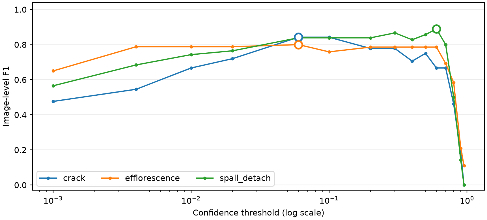
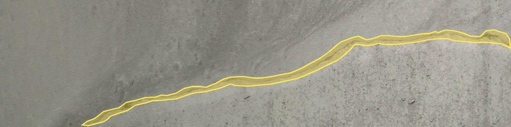
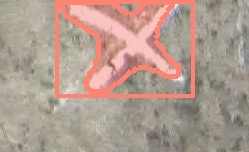
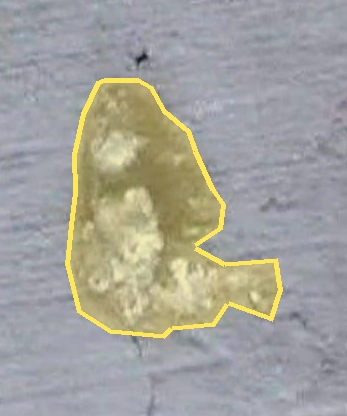
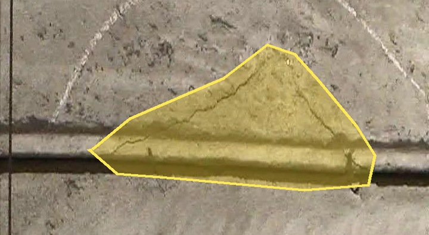

# 건설현장 크랙 탐지 프로젝트

콘크리트 표면 영상에서 **균열, 백태, 박리·박락**을 찾고 YOLOv8s-Seg로 각 결함의 영역을 표시했다. 1주차에는 영상과 라벨을 점검하고 주석 기준을 정했다. 2주차에는 원본 단위로 분할을 정리하고 맥북에서 60에폭을 학습했다. 3주차에는 저장한 `best.pt`로 마스크 성능과 이미지 단위 결함 선별 성능을 평가했다.

| 테스트셋 | Mask mAP50 | Mask mAP50-95 | 이미지 단위 Macro F1 |
| --- | ---: | ---: | ---: |
| 40장 | **0.6572** | **0.2861** | **0.7721** |

## 1. 문제 정의

| ID | 클래스 | 정의 |
| --- | --- | --- |
| 0 | 균열 (`crack`) | 콘크리트 표면에 선형, 분기형 또는 망상형으로 나타나는 불연속 |
| 1 | 백태 (`efflorescence`) | 수분 이동으로 표면에 형성된 흰색 또는 옅은 침착물 |
| 2 | 박리·박락 (`spall_detach`) | 표면층이 들뜨거나 손실되어 바탕이 드러난 부분 |

가늘고 분기하는 균열과 불규칙한 백태·박락의 윤곽을 표현하기 위해 바운딩 박스와 함께 인스턴스별 마스크를 예측했다. **Mask mAP**로 예측과 정답 영역의 겹침을 평가하고, **이미지 단위 ON/OFF**로 해당 결함이 들어 있는 영상을 선별하는 성능을 측정했다.

## 2. 데이터와 분할

| 분할 | 제공 이미지 | 사용 이미지 | 원본 ID 수 | 균열 폴리곤 | 백태 폴리곤 | 박리·박락 폴리곤 |
| --- | ---: | ---: | ---: | ---: | ---: | ---: |
| 학습 | 4,036 | 209 | 109 | 38 | 88 | 160 |
| 검증 | 40 | 40 | 40 | 10 | 27 | 16 |
| 테스트 | 40 | 40 | 40 | 14 | 19 | 14 |

- **1주차**에는 제공 이미지와 YOLO 세그멘테이션 라벨 4,116쌍을 대조했다. 대응 누락은 0건이었고, 학습 이미지 63장은 0바이트였다. 라벨은 클래스 ID와 정규화된 폴리곤 좌표로 구성됐다.
- **2주차**에는 증강·재인코딩 접미사를 제거해 원본 ID를 만들었다. 학습과 테스트에 함께 있던 원본 ID 1개의 학습 파일 55장을 제외했다. 검증·테스트와 축소 영상이 매우 비슷했던 학습 후보의 원본 10개도 제외했다. 완전 중복을 검사하고 원본별 증강본을 최대 1장으로 제한했다. 최종 분할 사이의 원본 ID 교집합은 0개였다.
- 결함 경계를 지정해 주석 예시 10장(균열 4개, 백태 3개, 박리·박락 3개)을 만들었다. 학습에는 제공 라벨을 사용했다. [파일별 분할 및 제외 기록](split_manifest.csv)

## 3. 모델과 학습

| 항목 | 적용 설정 |
| --- | --- |
| 모델과 초기 가중치 | YOLOv8s-Seg, `yolov8s-seg.pt` |
| 실행 환경 | Apple M5 맥북, 통합 메모리 24GB, macOS 26.6.2, PyTorch MPS |
| 입력 크기와 배치 | 640픽셀, 배치 4 |
| 학습 | AdamW, 초기 학습률 0.00015, 60에폭, seed 42, 조기 종료 patience 20 |
| 증강 설정 | Mosaic 0.0, MixUp 0.0 |

수업 예시의 960픽셀은 가는 균열의 세부 정보를 살리기 위한 설정이다. 이번 실습에서는 맥북의 연산량과 메모리 부담을 줄이기 위해 학습과 평가 모두 640픽셀을 사용했다. 결함 경계와 주변 콘크리트의 특징을 유지하기 위해 Mosaic과 MixUp을 껐다.

최종 검증을 포함한 학습 시간은 19분 32초였다. 로그에 기록된 최대 MPS 메모리 할당량은 3.56GB였고 메모리 부족 오류는 0건이었다. 학습 마스크 손실은 4.942에서 1.427로 감소했다. 검증 성능을 기준으로 저장한 `best.pt`의 검증 마스크 mAP50은 0.6450, mAP50-95는 0.2322였다. [60에폭 학습 기록](results/training.csv)

## 4. 테스트 성능과 임계값

### 마스크 성능

| 클래스 | 테스트 정답 인스턴스 | Mask AP50 | Mask AP50-95 |
| --- | ---: | ---: | ---: |
| 균열 | 14 | 0.2193 | 0.0961 |
| 백태 | 19 | 0.7574 | 0.3333 |
| 박리·박락 | 14 | 0.9950 | 0.4288 |
| **전체 평균** | **47** | **0.6572** | **0.2861** |

AP50은 마스크 IoU 0.50에서 계산한 AP다. AP50-95는 IoU 0.50부터 0.95까지 0.05 간격으로 계산한 AP의 평균이다. 박리·박락은 IoU 0.50에서 가장 높았으나 더 엄격한 IoU 기준을 포함하면 AP가 낮아졌다. 균열은 폭이 좁아 마스크가 조금만 어긋나도 겹치는 비율이 크게 달라진다. [마스크 평가 원본 값](results/test_summary.json)

### 검증셋 임계값 탐색

정답 라벨에 해당 클래스가 하나 이상 있으면 실제 ON으로 기록했다. 해당 클래스의 예측 신뢰도 최댓값이 임계값 이상이면 예측 ON으로 판정했다. 후보 점수를 미리 버리지 않도록 추론의 최소 신뢰도를 0.0009로 설정했다.

검증 영상 40장에서 0.001~0.95 사이의 후보 15개를 비교했다. 각 클래스에서 F1이 가장 높은 값을 고르고, 최고점이 여러 개이면 낮은 임계값을 선택했다. 결정한 값을 `thresholds.json`에 저장한 뒤 테스트 단계에서 읽어 그대로 적용했다.

| 클래스 | 선택 임계값 | 검증 Precision | 검증 Recall | 검증 F1 | 선택 이유 |
| --- | ---: | ---: | ---: | ---: | --- |
| 균열 | 0.06 | 0.889 | 0.800 | 0.842 | 0.10과 최고 F1이 같아 0.06 선택 |
| 백태 | 0.06 | 0.923 | 0.706 | 0.800 | 검증 F1 최고점 |
| 박리·박락 | 0.60 | 0.857 | 0.923 | 0.889 | 0.50 대비 검증 FP가 3건에서 2건으로 감소, FN 1건 유지 |



[선택된 임계값](results/thresholds.json) · [후보별 F1 원본 값](results/val_threshold_f1.csv)

### 테스트 이미지 단위 ON/OFF

| 클래스 | 임계값 | TP | FP | FN | TN | Precision | Recall | F1 |
| --- | ---: | ---: | ---: | ---: | ---: | ---: | ---: | ---: |
| 균열 | 0.06 | 7 | 0 | 6 | 27 | 1.000 | 0.538 | 0.700 |
| 백태 | 0.06 | 12 | 2 | 1 | 25 | 0.857 | 0.923 | 0.889 |
| 박리·박락 | 0.60 | 8 | 0 | 6 | 26 | 1.000 | 0.571 | 0.727 |
| **Macro F1** | | | | | | | | **0.7721** |

Macro F1은 세 클래스 F1의 산술평균이다. 백태는 영상 선별 F1이 가장 높았다. 박리·박락은 Mask AP50이 0.9950이었지만, 검증에서 선택한 0.60을 테스트 영상에 적용하자 정답 영상 14장 중 6장이 기준을 넘지 못했다. 마스크 AP50은 여러 신뢰도에서 정밀도와 재현율을 종합하고, ON/OFF는 선택된 임계값에서 영상별 판정을 센다. [테스트 ON/OFF 결과표](results/test_onoff.csv) · [영상별 클래스 신뢰도](results/test_scores.csv)

## 5. 오탐·미탐 사례

빨간 영역은 오탐 예측을, 노란 영역은 미탐 영상의 정답 폴리곤을 표시한다. 아래 점수는 해당 영상에서 모델이 낸 클래스별 최대 신뢰도다.

| 사례 | 오류 부위 | 관찰 및 해석 |
| --- | --- | --- |
| 균열 미탐 |  | 표면을 따라 휘어지는 가는 선이다. 신뢰도 **0.0228**로 기준 **0.06**에 못 미쳤다. 선의 일부가 주변 콘크리트와 명암 차이가 작아 놓치기 쉬운 형태였다. |
| 백태 오탐 |  | X자 표식 위에 예측 마스크가 잡혔다. 신뢰도 **0.0605**로 기준 **0.06**을 조금 넘었다. 밝은 표식과 침착물의 색을 혼동했을 가능성이 있다. |
| 백태 미탐 |  | 작은 흰 침착물이 여러 점으로 흩어져 있다. 최대 신뢰도는 **0.0090**으로 기준 **0.06**에 못 미쳤다. |
| 박리·박락 미탐 |  | 정답 영역이 수평 이음부에 접해 있다. 모델은 최대 **0.4608**의 박리·박락 후보를 냈고, 기준 **0.60**에서 이 영상은 OFF로 판정됐다. |

균열과 박리·박락의 테스트 FP는 각각 0건이었다. 클래스별 오류 사례 파일명, 신뢰도, 임계값은 [오류 사례 목록](results/error_cases.csv)에 정리했다.

## 6. 한계

테스트는 40장으로, 균열 정답 영상 한 장의 판정이 바뀌면 해당 클래스의 재현율은 약 7.7%p 달라진다. 파일명으로 확인한 원본 ID는 분할 사이에 겹치지 않았지만 같은 구조물에서 촬영한 별도 장면에 대한 일반화 성능은 따로 측정하지 않았다. 단일 모델과 단일 입력 크기로 평가했으며, 촬영 거리와 축척 정보가 없어 균열의 실제 폭이나 박락의 면적·깊이는 산출하지 않았다.

## 7. 재현 방법

Python 3.12.14, PyTorch 2.15.0, Ultralytics 8.4.189를 사용했다. 제공 데이터 폴더에 `images/{train,val,test}`와 `labels/{train,val,test}`가 있어야 한다. 명령의 `/path/to/dataset`을 실제 제공 데이터 경로로 바꿔 실행한다.

```bash
python3 -m venv .venv
source .venv/bin/activate
python3 -m pip install -r requirements.txt

python3 prepare_data.py "/path/to/dataset" split_manifest.csv work/dataset
python3 evaluate.py tune --data work/dataset --weights best.pt --output work/eval
python3 evaluate.py test --data work/dataset --weights best.pt --output work/eval
```

`prepare_data.py`는 2주차 분할 목록을 이용해 작업 폴더에 이미지와 라벨 사본을 배치하고, 현재 경로에 맞는 `data.yaml`을 생성한다. `tune`은 검증셋만 읽고, `test`는 저장된 임계값과 체크포인트 및 검증셋이 일치하는지 확인한 후 테스트셋을 평가한다. MPS 접근이 어려운 환경에서는 두 평가 명령 모두에 `--device cpu`를 붙인다.

| 파일 | 역할 |
| --- | --- |
| `prepare_data.py`, `split_manifest.csv` | 데이터 분할 복원, 원본 ID 중복 확인, `data.yaml` 생성 |
| `evaluate.py`, `code_metrics.py` | 검증 F1 탐색, 테스트 마스크 mAP·ON/OFF 평가, 오류 이미지 추출 |
| `train.py` | 2주차 YOLOv8s-Seg 학습 |
| `best.pt` | 2주차 최종 가중치 |
| `results/` | 에폭별 학습 기록, 검증 임계값 곡선, 테스트 지표와 오류 사례 |

2주차 학습부터 재실행하려면 공식 시작 가중치 `yolov8s-seg.pt`를 프로젝트 폴더에 두고 아래 명령을 실행한다. 위 평가 명령의 가중치 경로를 새 학습에서 생성한 `work/train/weights/best.pt`로 바꾼다.

```bash
python3 train.py --data work/dataset/data.yaml --weights yolov8s-seg.pt --output work/train
```

## 결함 표시 기준

| 클래스 | 포함 및 경계 기준 | 제외 기준 |
| --- | --- | --- |
| 균열 | 실제로 이어지는 가는 선과 분기의 양쪽 경계를 좁게 감싼다. | 폭이 일정한 시공 이음선, 케이블, 긁힘, 그림자. |
| 백태 | 흰 침착물이 주변과 색 또는 질감으로 구별되는 곳을 따라 그린다. 경계가 흐리면 침착이 확인되는 영역까지 표시한다. | 규칙적인 X자·문자 표식, 반사광, 흰 도장, 밝기 차이만 있는 영역. |
| 박리·박락 | 들뜬 가장자리, 재료 탈락 자국, 노출된 바탕이 보이는 부분을 감싼다. 손상이 이음부에 닿으면 이음선과 손상 윤곽을 구분한다. | 정상 이음부, 보수재 경계, 단순 얼룩, 내부 들뜸만 의심되는 곳. |

보이는 결함 하나당 폴리곤 하나를 그린다. 떨어진 영역은 별도 인스턴스로 기록하고, 여러 클래스가 한 영상에 있으면 영역별로 라벨을 부여한다. 가려지거나 영상 밖으로 이어지는 부분은 보이는 경계까지만 표시한다. 경계나 유형을 판단하기 어려운 경우에는 파일명, 위치, 사유를 기록해 보류하고 재검토한다. 균열과 백태의 주석 경계, 정상 표식을 제외하는 사례, 이음부에 접한 박리 사례는 위 오류 이미지에서 확인할 수 있다.
